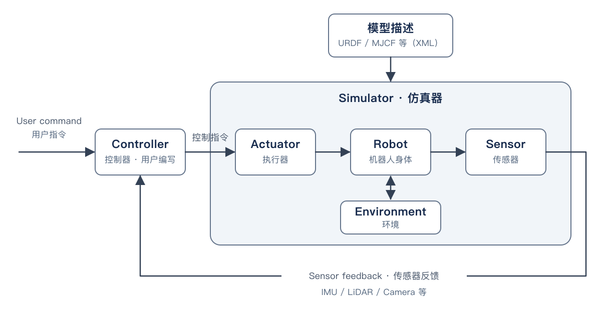
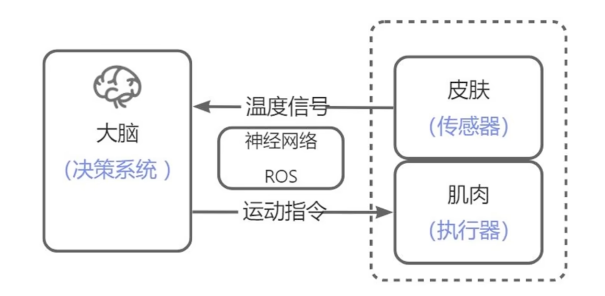
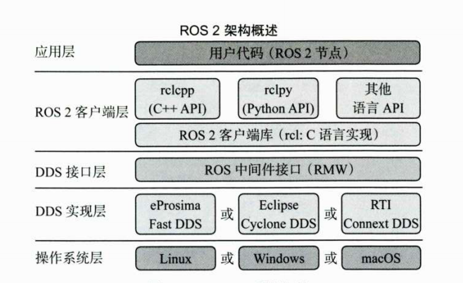
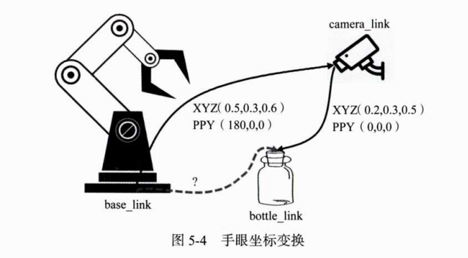
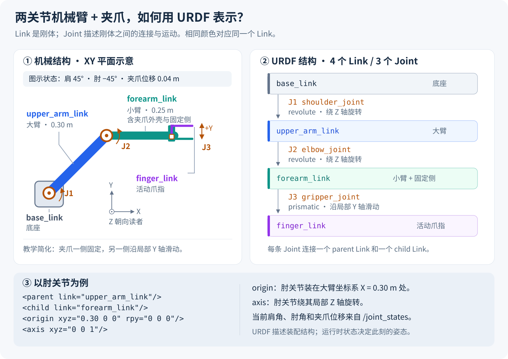
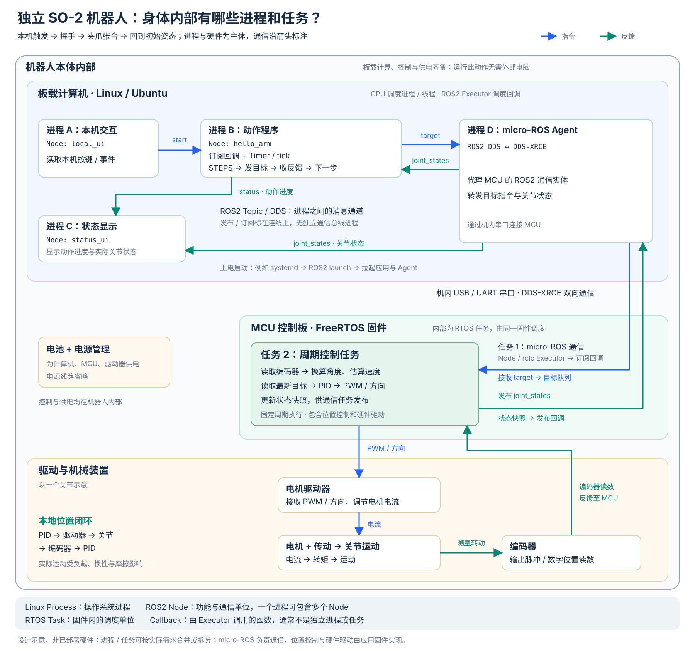
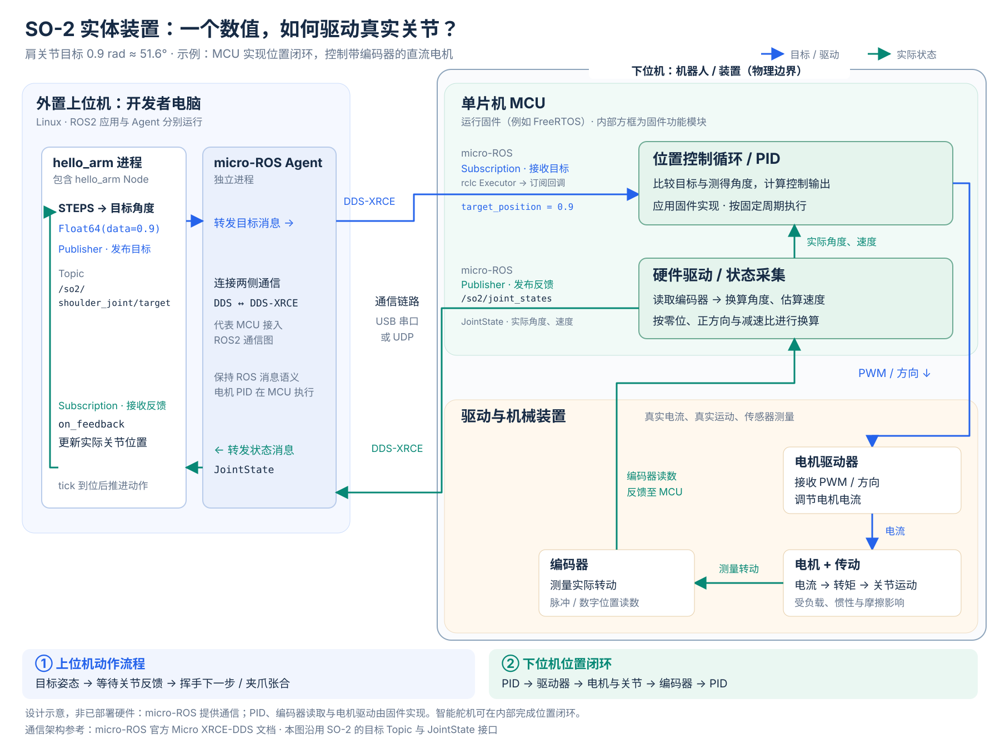
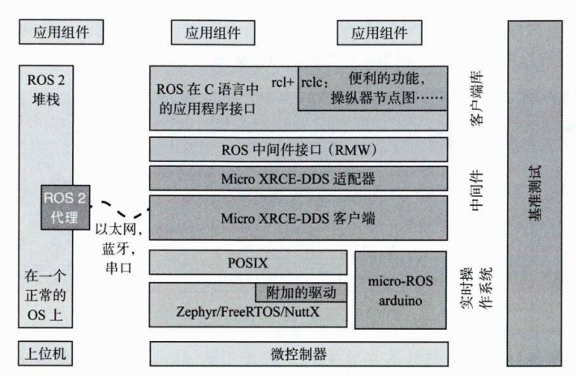
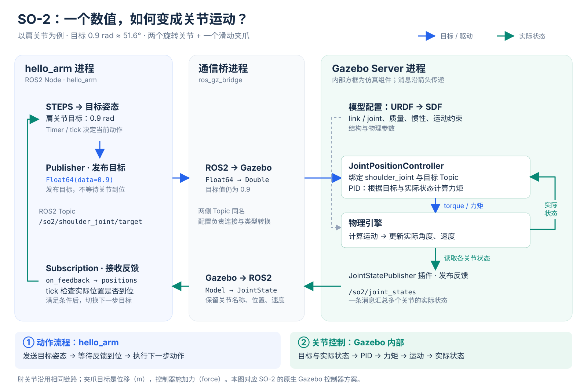

---

layout: post
title: 机器人软件
category: 技术
tags: MachineLearning
keywords: deepresearch deepsearch

---

<script>
  MathJax = {
    tex: {
      inlineMath: [['$', '$']], // 支持 $和$$ 作为行内公式分隔符
      displayMath: [['$$', '$$']], // 块级公式分隔符
    },
    svg: {
      fontCache: 'global'
    }
  };
</script>
<script async src="/public/js/mathjax/es5/tex-mml-chtml.js"></script>

* TOC
{:toc}

## 简介

## 数字孪生

simulation，modeling physical model to do prediction. Real-world physics are often described by functions/静态关系, ODE/常微分方程(状态随时间怎么变化) or PDE/偏微分方程。All simulators essentially solve the ODEs and/or PDEs corresponding to a physical process of interest.

让机器人先在Simulator中行走的原因很简单。真实的机器人摔倒就会损坏，一次实验需要数分钟，而且它无法自主运行一整夜。而在Simulator中，摔倒数万次也毫无成本，运行速度还远快于实时。

数字孪生不仅有相同的外观（Geometry），还有相同的物理属性（Physics），能接收传感器数据（Sensing）并响应控制指令（Actuation）。

||传统仿真|数字孪生|
|---|---|---|
|焦点|特定过程|完整实体|
|范围|局部、离线|全局、实时同步|
|目的|分析与验证|预测、监控、闭环交互|
|例子|一个齿轮的受力分析，一个电路的性能模拟|在数字空间创建物理实体的动态虚拟副本|

在robot 领域，就是为实体的机械臂创建一个它的数字孪生体，作为主要的开发、测试和实验平台。
1. 物理成本，实体机器人价格昂贵，在仿真中，我们可以”撞坏“无数个虚拟机器人，成本为零。
2. 时间成本，物理实验受场地、时间限制，在仿真中，我们可以同时运行成百上千个实验，24小时不间断。
3. 迭代成本，修改一个物理样机的设计可能需要数周时间，而在仿真中，修改一个模型参数（如臂长、电机扭矩）可能只需要几秒钟。
4. 设备安全、人员安全。
5. 前端开发与后端解耦，算法工程师可以在仿真中开发调试，无需等待物理样机制造完成。这实现了软硬件开发的并行化。
仿真提供一个”纯净“的、排除了物理不确定性的理想环境，便于我们首先验证算法逻辑的正确性。

数据驱动AI的困境：现代AI，尤其是深度学习，是名副其实的”数据饕餮“。训练一个图像识别模型需要数百万张图片，那么，训练一个机器人抓取模型需要什么？让一个实体机器人尝试抓取100w次，可能需要数年时间，并且硬件早已报废。仿真环境是强化学习算法最理想的训练场，Agent可以在虚拟世界里进行数亿次的试错，学习从失败中总结经验，而这一切都可以在几个小时内完成。此外，还能通过”领域随机化“技术，生成千奇百怪的数据，随机改变光照、纹理、物体位置、物理参数……，用这些数据训练出的模型，在真实世界中的泛化能力（Generalization）会更强。“在仿真中大规模训练，在现实中少量微调”已经成为公认的、最高效的机器人AI开发范式。



选择Simulator的五个标准。PS： 不同的simulator 支持的ue 不同，sensor不同，env不同，但干的活儿都如上图。
1. physical validity and stability of contact. 接触的物理有效性与稳定性。行走是足部与地面接触的问题。在接触计算不稳定的引擎中，机器人一接触地面就会弹跳或抖动。这种噪声会污染训练数据。
2. computational cost. 程序必须在单个 CPU 上以快于实时的速度运行。
3. 模型描述的直观性。描述躯干、腿部和关节的文件必须采用人类能够阅读和编辑的形式。
4. accessibility of control at the joint level. 引擎必须将关节坐标视为其基本单元，支持直接读写关节角度和扭矩。
5. 可靠性与生态系统


### Gazebo

ROS2 官方原生仿真

### MuJoCo

MuJoCo stands for **Mu**lti-**Jo**int dynamics with **Co**ntact(多关节接触动力学). It is a general purpose physics engine that aims to facilitate research and development in robotics, biomechanics, graphics and animation, machine learning, and other areas which demand fast and accurate simulation of articulated(铰接的) structures interacting with their environment.

```xml
<mujoco>
  <option timestep="0.002" gravity="0 0 -9.81"/> <!--gravity重力沿 Z 轴向下, timestep每个物理步推进 0.002 秒-->
  <worldbody> <!-- 整个场景的根节点，代表固定的世界坐标系（world frame）-->
    <!-- ground一个地面-->
    <geom name="ground" 
          type="plane"
          size="2 2 0.1"/>
    <body name="ball">
      <!--关节：这里限制小球只能沿 Z 轴上下移动-->
      <joint name="vertical"
             type="slide"
             axis="0 0 1"/>
      <!--一个物体，有半径 0.05 米、质量 1 千克的球形几何体/geom-->
      <geom type="sphere"
            size="0.05"
            mass="1"/>
    </body>
  </worldbody>
</mujoco>
```

```
import mujoco
m = mujoco.MjModel.from_xml_string(xml4)
m = mujoco.MjModel.from_xml_path('****.xml')
d = mujoco.MjData(m)
```

separation of model and data
1. mjModel is the compiled constants. Everything that does not change during simulation: 物体和关节的数量、每个物体的质量与惯量、仿真选项等。它在读取 XML 文件时创建，之后仅进行读取操作。
2. mjData is everything that changes over time. 它包含关节位置 qpos、关节速度 qvel、控制输入 ctrl、当前时间 time，以及由这些量计算得出的派生量（刚体的世界坐标 xpos、接触列表 contact、关节力等）。

```
model = mujoco.MjModel.from_xml_string(xml)
data = mujoco.MjData(model)
# 把小球放在 1 米高，位移就是球心的高度。
data.qpos[0] = 1.0
# 让物理世界运行一秒, 500 步 × 每步 0.002 秒 = 1 秒仿真时间
for step in range(500):
    mujoco.mj_step(model, data)
    if (step + 1) % 100 == 0:
        print(
            f"时间={data.time:.2f}s，"
            f"高度={data.qpos[0]:.3f}m，"
            f"竖直速度={data.qvel[0]:.3f}m/s"
        )  
    # 小球在重力作用下自然下落
```

## ROS（Robot Operating System）

2006 年，Eric Berger 和 Keenan Wyrobek 通过调查发现，当时的机器人公司在开发机器人时把八成的精力都花在了搭建机器人的通信机制和基础工具上，反而没时间完善机器人的决策系统。

硬件是机器人的载体，软件则赋予智能机器人灵魂，智能机器人开发需要一个机器人操作系统作为基础。ROS 是开源的，由一组软件库和若干工具组成，追求的是稳定、安全和实时的通信能力（**核心是通信**），并非经典意义上的操作系统。


ros2 系统架构



1. ROS 2 的核心通信是采用第三方的通信组件来实现的，这个第三方就是数据分发服务（Data Distribution Service，DDS），DDS 基于实时发布订阅协议（Real-time Publish-Subscribe，RTPS）来实现数据分发。
2. 因为要支持不同厂家的DDS，同时又需要对外保持一致，所以ROS 2定义了RMW（ROS Middleware Interface，ROS中间件接口），再由不同DDS进行实现，为ROS 2客户端层提供统一的调用接口。举例来说，DDS接口层类似于USB接口的标准，而DDS实现层就是不同厂家根据标准生产的USB设备。
3. ROS 2 客户端层提供了不同编程语言的 ROS 2 客户端库（ROS 2 Client Library，RCL），使用这些库提供的接口，可以完成对 ROS 2 核心功能的调用，如话题、服务、参数和动作通信机制。
4. 所有基于 RCL 开发的程序都属于应用层，后续开发的机器人应用也属于这一层。

四大通信机制
1. topic，基于发布-订阅模式的通信方式，允许节点之间异步交换数据，单向，即 发布者 ( Publisher) 将消息 发 布 到 某 个 话题 上,订阅者 ( Subscriber) 订阅话题即可获取数据
2. service，双向(client/server)，同步通信方式，客户端发送请求，服务端处理并返回结果
3. parameter，用于机器人参数的设置和读取
4. action，client/server, 支持复杂行为的通信方式，服务端可以反馈处理进度，客户端可以取消请求。

ROS 2 为基础的软件栈
1. 编程模型，以 Node（节点）作为基本的功能和通信单位，逻辑功能单元，一个进程可以运行多个 Node(反之不可以)，ros2 提供了 rclpy.node.Node 父类。通过topic、service和action与其他Node协作
1. 机器人通用能力
  1. 坐标变换 ( Coordinate Transformation, TF)，,相机 固定 在右上 方的camera_link处,机 械 臂的底座固定在 base_link 处 。从 base_link 到 camera_link 的位 置是固定 不 变 的 ,图中已经给出了变换关系,平移分量(0.5,0.3,0.6),旋 转分量 ( 180,0,0)。相 机通过识别得到瓶子 bottle_link 的坐标 ,其中平移分量为〈0.2,0.3,0.5), 旋转分量为(0,0,0)。如果机械臂想夹取瓶子 ,就需要知道base_link到bottle_link之间的坐标关系。
  
2. 机器人领域框架。nav2（导航）/movelt2（机械臂运动规划）


## 机器人世界的建筑蓝图


||||
|---|---|---|
|在xml的基础上对标签的名字有规定|URDF|MJCF|
|仿真器|Gazebo|MuJoCo + MuJoCo Warp|
URDF 和MJCF都能描述身体，可以相互转换。MJCF 还可以直接描述整个仿真场景、执行器及仿真选项。

### MJCF
 
mujoco "designed to be human-readable and editable"  as far as possible,A robot is written as a **tree structure** starting from the torso, with legs, joints, and shapes nested inside. URDF 会先列出所有links，再通过joints将它们连接起来，缺乏用于编写执行器、接触参数和传感器的字段，导致运动学仿真所需的关键信息存在缺失。MJCF is a tree of body (bone), joint, and geom (flesh), and inertia/惯性 is computed automatically from shape and mass/质量. Size arguments are half-sizes, and `<default>` classes reduce repetition.

How to define a robot control system? We focus on rigid body system: Multiple rigid bodies interconnected through joints. How to define a rigid body? PS: 看xml的骨架就是看4个东西
1. Where is it? body
2. How does it look? geom
3. How does it connect to others? joint
4. Its physical properties? inertial

专用格式规范 `<mujoco> ...</mujoco>` 下包含3大类
2. worldbody 物理模型，运动学**tree**。整个场景的根节点，代表固定的世界坐标系（world frame）。不能给它添加关节让它运动。
1. body,body is the bone. 场景中的一个刚体，例如小车、机械臂的一段连杆、机器人的躯干，它有自己的局部坐标系（body frame）。包含joint（两个body 之间有约束关系）/geom/body/inertial/site等。**MJCF 中的 body 嵌套描述运动学上的父子关系**；它本身不要求子 body 的几何形状位于父 body 的几何形状内部。
  1. joint写在刚体内部时表示该刚体可按此方式相对于其父刚体运动degree of freedom/dof/自由度。普通 body 没有 joint 时，会与父 body 保持固定关系，如同与父刚体焊死在一起。父 body 动，它跟着动，但两者不能相对运动。
  2. geom, 结合体，静态的、动态的。它是可见的形状和碰撞形状，若为其赋予质量，物体的质量和惯性便由此计算得出。
  3. inertial(指定geom 的一些性质)/site( 一个点位，挂在某个body上)， inertial 用来描述一个 body 的质量、质心和转动惯量，让 MuJoCo 算出“受到力或力矩后，它会怎样运动”。
3. actuator，我们对机器人实现控制， 实际上就是对驱动器进行控制。拿到一个xml 首要看的就是有哪些actuator以及它所驱动的joint
  1. `data.ctrl[actuator index]` =xx 就是给actuator 输入
4. tendon，传动器
5. sensor，传感器，挂在某个site 上
1. 设置  compiler/asset/default 
  1. asset 可复用资源库, material定义颜色、反光等外观属性; texture提供表面贴图; mesh提供三维几何形状，常被geom refer。
  1. default  `<defalut><geom type=box></defalut>` 则以后你声明 geom 不写type 就是box

描述一个 body 放在哪里，需要回答两个问题：
1. pos, 当前坐标系的原点，在父坐标系中的哪个位置
2. `<euler>`, or `<quat>` or `<axisangle>`: specify frame orientation relative to parent frame, optional (default orientation matrix is identity)。	当前坐标系的轴，相对于父坐标系转了多少
```xml
<worldbody>
    <body name="BaseLink" pos="0 0 0.1">
        <!--link1 的原点位于BaseLink 坐标系中的 (0, 0.1, 0.125)。-->
        <!--按角度单位为度理解，`link1` 的坐标轴相对 BaseLink 绕x轴旋转了-90 -->
        <body name="link1" pos="0 0.1 0.125" euler="-90 0 0">
            <!-- link2 的原点位于link1原点 z轴走 0.2-->
            <body name="link2" pos="0 0 0.2">
            </body>
        </body>
    </body>
</worldbody>
```

描述body相对于 parent body的相对运动 joint type, axis 指定滑动或转动的方向(在所属 body 的局部坐标系中表达)
| `type` | 允许怎样运动 | 自由度 | 直观例子 |
|---|---|---:|---|
| `slide`（滑动关节） | 沿指定轴平移 | 1 | 抽屉沿导轨抽出、推入 |
| `hinge`（铰链关节） | 绕指定轴旋转 | 1 | 门绕门轴转动 |
| `free`（自由关节） | 三个方向平移，加三个方向旋转 | 6 | 空中的物体，可以移动、翻滚 |
| `ball`（球关节） | 允许绕关节中心转动，有 3 个旋转自由度 | 3 | |

```xml
<!-- 沿自身 body 坐标系的 x 轴滑动 -->
<joint name="cart_slide" type="slide" axis="1 0 0"/>
<!-- 绕自身 body 坐标系的 y 轴转动 -->
<joint name="pole_hinge" type="hinge" axis="0 1 0"/>
```
joint 定义“允许怎么动”，actuator 才负责“怎样施力驱动它”。有 hinge 不代表自带电机；一根没有电机的杆子，也能在重力作用下绕铰链摆动。

**joint 决定“允许怎么动”， inertial则影响“让它动起来、加速或停下来，需要多大的力”**。想象电机带动一根机械臂连杆：连杆质量更大，同样的力推动它，平移加速度更小。inertial 就是把这些物理信息交给仿真器。

```xml
<inertial
    pos="0 0 0.1"  # 质心位于 body 局部坐标系的 (0, 0, 0.1)，单位 m
    mass="1"  # body 的质量为 1 kg 
    diaginertia="0.01 0.01 0.002"/> # 绕穿过质心的三个惯性主轴的转动惯量，单位 kg·m²
```
inertial frame（惯性属性坐标系）：原点在质心，三根轴沿惯性主轴。它的朝向可以通过 quat 等属性指定，不一定与 body frame 一致。省略inertial时，MuJoCo 可以根据 body 上的 geom 形状、质量或密度推算这些属性，简单小球、方块模型通常可以这样做。 PS： pos 写在不同元素上，意义不同

### URDF

仿真的第一步是对机器人进行建模。URDF(Unified Robot Description Format) 是 ROS 世界中描述机器人的标准语言，可以看成是机器人三维模型说明书
1. 链接/Links
2. 关节/Joints，一般对应一个电机

比如我们要向计算机描述一个人的身体结构，我们会怎么说？ 这个人有一个驱干，驱干上连着一个脖子，脖子上连着一个头……，我们需要一种标准化的语言来精确描述这种连接关系和每个部件的属性。urdf 基于xml格式的文件，专门用来描述机器人的运动学模型和动力学模型，主流机器人软件和仿真器都可以加载和使用。



这个简化机械臂由 4 个 link 和 3 个 joint 组成：肩、肘关节负责旋转，夹爪关节负责开合。夹爪外壳与固定爪指和小臂没有相对运动，因此合并为同一个 link。URDF 描述装配结构和运动约束，当前关节角度及夹爪位移由 /joint_states 提供。robot_state_publisher 结合两者计算各 link 的坐标变换，并发布到 TF。

```urdf
<?xml version="1.0"?>
<!-- Teaching model: two revolute arm joints and one sliding gripper finger.
     XY plane, +Z rotation; metres and radians. Visual geometry only:
     collision, inertial properties and hardware control are omitted. -->
<robot name="two_joint_arm">
  <material name="base_gray"><color rgba="0.39 0.45 0.55 1"/></material>
  <material name="arm_blue"><color rgba="0.15 0.39 0.92 1"/></material>
  <material name="forearm_teal"><color rgba="0.05 0.58 0.53 1"/></material>
  <material name="finger_purple"><color rgba="0.58 0.20 0.92 1"/></material>

  <link name="base_link">
    <visual>
      <origin xyz="0 0 -0.025"/>
      <geometry><box size="0.10 0.09 0.03"/></geometry>
      <material name="base_gray"/>
    </visual>
  </link>
  <link name="upper_arm_link">
    <visual>
      <origin xyz="0.15 0 0"/>
      <geometry><box size="0.30 0.035 0.02"/></geometry>
      <material name="arm_blue"/>
    </visual>
  </link>
  <link name="forearm_link">
    <visual>
      <origin xyz="0.125 0 0"/>
      <geometry><box size="0.25 0.03 0.02"/></geometry>
      <material name="forearm_teal"/>
    </visual>
    <!-- Palm and fixed finger belong to the same rigid body as the forearm. -->
    <visual>
      <origin xyz="0.24 0.008 0"/>
      <geometry><box size="0.026 0.06 0.02"/></geometry>
      <material name="forearm_teal"/>
    </visual>
    <visual>
      <origin xyz="0.285 -0.012 0"/>
      <geometry><box size="0.07 0.008 0.02"/></geometry>
      <material name="forearm_teal"/>
    </visual>
  </link>
  <link name="finger_link">
    <visual>
      <origin xyz="0.035 0 0"/>
      <geometry><box size="0.07 0.008 0.02"/></geometry>
      <material name="finger_purple"/>
    </visual>
  </link>

  <joint name="shoulder_joint" type="revolute">
    <parent link="base_link"/>
    <child link="upper_arm_link"/>
    <origin xyz="0 0 0" rpy="0 0 0"/>
    <axis xyz="0 0 1"/>
    <limit lower="-1.57" upper="1.57" effort="5" velocity="1"/>
  </joint>
  <joint name="elbow_joint" type="revolute">
    <parent link="upper_arm_link"/>
    <child link="forearm_link"/>
    <origin xyz="0.30 0 0" rpy="0 0 0"/>
    <axis xyz="0 0 1"/>
    <limit lower="-1.57" upper="1.57" effort="5" velocity="1"/>
  </joint>
  <joint name="gripper_joint" type="prismatic">
    <parent link="forearm_link"/>
    <child link="finger_link"/>
    <!-- At q=0 the two finger surfaces touch; positive local Y opens them. -->
    <origin xyz="0.25 -0.004 0" rpy="0 0 0"/>
    <axis xyz="0 1 0"/>
    <limit lower="0" upper="0.04" effort="10" velocity="0.05"/>
  </joint>
</robot>
```

下面是让机械臂挥手的ros2 代码
1. STEPS 预先定义好了 各个joint 的指令参数
2. 定义了3个 topic，用于给joint 发指令
3. 对仿真器 Gazebo 配置了一个topic= "/so2/joint_states"，用于接收joint 状态

```
import rclpy
from rclpy.node import Node
from rclpy.qos import qos_profile_sensor_data
from sensor_msgs.msg import JointState
from std_msgs.msg import Float64

JOINTS = ["shoulder_joint", "elbow_joint", "gripper_joint"]

# 每一步：肩角度(rad)、肘角度(rad)、夹爪开度(m)
STEPS = [
    (0.9, -0.6, 0.03),                     # 准备
    *[(0.9, e, 0.03) for e in [0.25, -0.9] * 3],  # 挥手
    *[(0.9, -0.9, g) for g in [0.038, 0.002] * 2], # 张合
    (0.65, -1.1, 0.03),                    # 回到初始姿态
]


class HelloArm(Node):
    def __init__(self):
        super().__init__("hello_arm")
        self.step = 0
        self.positions = {}

        self.publishers_by_joint = {
            name: self.create_publisher(
                Float64, f"/so2/{name}/target", 10
            )
            for name in JOINTS
        }
        self.create_subscription( # 订阅关节状态
            JointState,
            "/so2/joint_states",
            self.on_feedback,
            qos_profile_sensor_data,
        )
        self.timer = self.create_timer(0.1, self.tick)

    def on_feedback(self, msg):
        self.positions = dict(zip(msg.name, msg.position))

    def tick(self):
        if not all(name in self.positions for name in JOINTS):
            return

        target = STEPS[self.step]

        # 告诉各个关节：“你应该转到 / 移到这里。”
        for name, value in zip(JOINTS, target):
            self.publishers_by_joint[name].publish(Float64(data=value))

        # 根据实际反馈判断到位，而不是发完指令就当作完成。
        tolerances = [0.025, 0.025, 0.0015]
        reached = all(
            abs(self.positions[name] - value) < tolerance
            for name, value, tolerance in zip(JOINTS, target, tolerances)
        )
        if reached:
            self.step += 1
            if self.step == len(STEPS):
                self.get_logger().info("打招呼完成")
                self.timer.cancel()


def main():
    rclpy.init()
    node = HelloArm()
    try:
        rclpy.spin(node)
    finally:
        node.destroy_node()
        rclpy.shutdown()


if __name__ == "__main__":
    main()
```


## A Minimum of Physics-Engine Literacy: timestep, solver, and contact

MuJoCo不会为每个物体单独设定位置和朝向，而是将关节角度作为其基本坐标/generalized coordinates。机器人的状态会直接以“12个关节角度和12个关节速度”的向量形式呈现。这是控制器读取的数据，也是强化学习所观测到的数据。如果采用物体坐标的方法，就必须每次都反向计算关节角度。此外，关节以树形结构连接这一特性，在关节坐标体系中会被自动遵循，因此腿部与躯干分离这类数值误差从一开始就不会出现。控制方面也是如此。MuJoCo 内置了actuator/执行器模型， including motors, position servos, velocity servos, PID, and even muscles，在 Python 中，通过向data.ctrl数组赋值即可实现控制。

mujoco.mj_step(model,data)，根据当前状态和受力，算出整个仿真世界经过一小段（model.opt.timestep）时间后的状态。每运行mj_step 一次之后，mujoco会根据传入的模型以及模型对应的数据进行计算（比如小球重力往下落）。若model.opt.timestep=0.002，仿真时间就前进 0.002 秒，即 2 毫秒。调用 500 次，就是推进 1 秒仿真时间。
```
for _ in range(500):
    mujoco.mj_step(model, data)
```
A single mj_step passes in order through the stages  calls the "computation pipeline"
```
当前的位置、姿态和速度
         +
重力、控制输入、外力、接触约束等
         ↓
计算各个自由度的加速度
         ↓
通过数值积分，更新速度、位置和姿态
         ↓
仿真时间增加 timestep
```
1. 正向运动学/Forward kinematics：根据关节角度计算每个刚体/rigid body（对应软体）的世界位置和姿态。
2. 动力学项/Dynamics terms：计算偏置力（如重力、离心力和科里奥利力）以及惯性矩阵。
3. 碰撞检测/Collision detection：找出相接触的形状对并构建接触列表。
4. 约束求解器/Constraint solver：通过凸优化求解接触力和关节限位力。
5. 加速度计算/Acceleration computation：求解运动方程以得到关节加速度。
6. 积分/Integration：在一个时间步内，通过加速度更新速度，通过速度更新位置。

步骤1至5为mj_forward，mj_forward 仅根据当前的 qpos 和 qvel 计算衍生量，时间不会推进。mj_step 包含了 mj_forward 的功能，同时还会计算力，然后通过积分将时间推进一个步长。mj_step 更新物理状态，画面刷新需要另行调用 Viewer 或 Renderer。

1. 按名称访问。你可以按照 XML 中给定的名称查找元素，例如 model.joint("shoulder")、data.body("upper") 和 data.site("tip")
2. 控制量存储在 mjData 中。通过`data.ctrl[:] = [3.0, 0.0]`给肩部电机输入3牛·米的扭矩，手臂就抬了起来。
3. 一个模型可以关联多个数据。因为常量和状态是分离的，并行运行多个训练环境时就依赖于这一特性。


物理引擎基础素养
1. 模拟器将连续时间切分为若干小段，并逐段进行计算。这段时间的大小即为时间步长，MuJoCo 的默认值为 0.002 秒
2. 积分器：相同时间步，不同结果。积分方法MuJoCo 提供了四种：欧拉；implicitfast；implicit；RK4。
3. solver: How Contact Forces Are Computed。约束求解器也分为三种。PGS是传统的游戏引擎方法，CG为共轭梯度法，而默认的Newton则采用精确牛顿迭代法。
4. Contact: Soft, and Readable 接触：柔软且易读。默认情况下，1 千克的盒子会陷入地板 0.11 毫米。采用刚性接触模型时该值应为 0，真正的橡胶鞋底的下陷量大约就是这个数值。设置机器人足部的 solref 时，你需要用到这种触感。设置得太硬，落地时会弹起；设置得太软，足部又会陷入地面。

```
while data.time < duration:
    data.ctrl[:] = controller(data)   # read the state and compute the control input
    mujoco.mj_step(model, data)       # advance the physics by one step
    log.append(data.qpos.copy())      # record what you need
```

MuJoCo 并非适用于所有场景。如果你需要在一块 GPU 上同时运行数千个机器人，将训练时间从数天缩短至数小时，那么 NVIDIA Isaac Lab 已接近成为行业标准。MuJoCo 阵营也正朝着该方向推出 MJX 和 MuJoCo Warp。

## 算法

### 机器人导航

Nav2/Navigation2  是基于 ROS 2 构建的导航框架，包含 导航任务编排、代价地图、规划服务、控制服务、恢复行为等，具体到某个组件（比如规划器），Nav2 定义了规划器接口GlobalPlanner ，具体算法以插件的形式被加载使用。
1. 要想导航 ,就要先确定当前位置和目标点的位置 , 如何确定位置其实就是定位问题。
2. 知道了当前位置和目标位置信息后 ,要想规划出行走路线 ,还需要知道哪里是可以走的，哪里是不能走的。此时就需要一张标有环境信息的地图
  1. SLAM ( Simultaneous Localization andMapping, 同步定位与地图构建)
3. 解决了地图和定位问题 后 ,我们再来考虑如何走的问题
  1. 全局路径规划。确认一条从当前位置到目标位置之间的路线 ,理想中这条路线应该符合某些要求 ,比如能避开所有障碍物且耗时最少。要实现这一效果就需要在地图上标记代价信息, 比如走路况差的路线要花费更多的时间, 付出更大的代价。
  2. 局部路径规划。在按照全局路线行走时,前方可能会出现一些障碍物 ,比如开车时发现前方一段车道正在封闭维修,此时就需要绕开维修车道 。但机器人要想绕过去 ,第一步要把障碍物加到地图中 ,然后对当前这一小段路线重新进行路径规划。因为这个障碍物是小范围和动态的 ,所以我们往往会针对当前小范围环境,重新创建一张局部的代价地图,然后进行路径规划 。
  3. 考虑全局路径和局部路径以后 ,有时我们还要面对一些特殊情况 ,比如行走过程中卡住或者被行人挡住 ,且找不到局部路径绕过去。此时就需要有一些相应的行为帮助机器人脱离困境 , 比如当前进卡住时尝试后退 ,当被人挡住时播放“请让路 ”语音。对于这些遇到故障问题时控制动作，我们称之为恢复行为。


## 机器人控制系统


## 部署

实际运行时
1. 板载计算机。机器人内部的计算机运行 Linux + ROS2 进程，通过驱动程序、控制板连接电机
  
2. 外置计算机。开发者电脑（上位机）运行 Linux + ROS2 进程，通过 USB、串口、CAN、以太网等连接装置（下位机）的MCU控制板。电脑一般不会直接操作电机的供电线。
  1. MCU 通常运行固件或实时操作系统（RTOS），不运行完整 Ubuntu。 常见例子有 STM32、ESP32。 micro-ROS。





仿真时，开发者电脑运行 Linux + ROS2 进程，仿真器提供虚拟硬件及其控制、状态反馈接口；独立运行的 ROS2 程序通过适配层发送关节指令并接收反馈，形成控制闭环。




