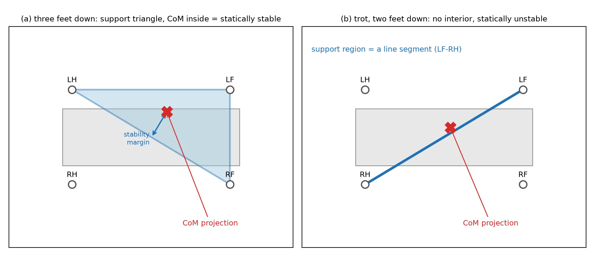
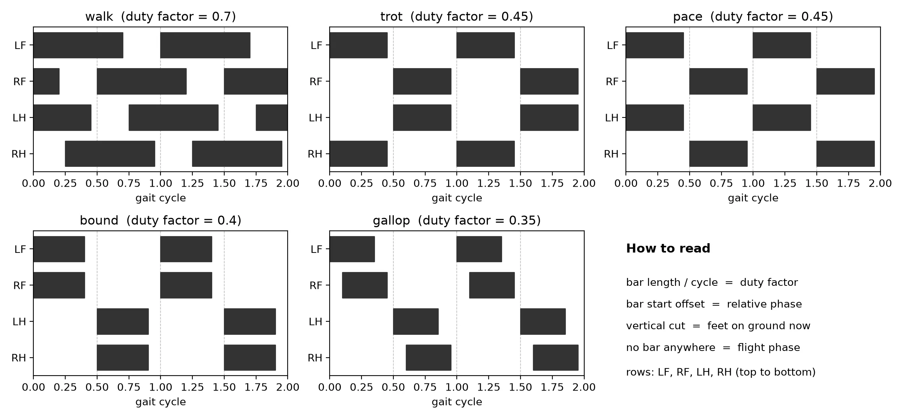

---

layout: post
title: 机器人运动学
category: 技术
tags: MachineLearning
keywords: deepresearch deepsearch

---

* TOC
{:toc}

## 简介

AI is excellent at answering questions. But a beginner's real problem is not failing to find answers; it is not knowing what to ask, and in what order. Concepts have dependencies. If you cannot read a gait diagram, you cannot diagnose your own robot's gait. If you have not experienced the limits of open-loop control firsthand, you cannot feel why reinforcement learning is needed. Which concept to place before which, where to make you fail on purpose: this design of the order is half of education(这种顺序的设计是教育的一半), and it comes from the experience of someone who walked the road first and got lost on it. The power of a book as a medium lies not in the amount of information but in this structure(书籍作为一种媒介的力量，不在于信息量的多寡，而在于这种结构). Individual answers, AI gives faster. But the map of the journey is still drawn by the person who walked it first.

## 理论基础

1. 高中学习的运动学是质点运动学，即忽略一个物体自己本身的形状和姿态，只把它当成一个点，研究这个点的运动过程和轨迹。 描述一个物理的运功状态，需要两个量/位姿(Pose)：位置(xyz 空间坐标) + 姿态（旋转矩阵/欧拉角等）。以一架无人机为例：
  - 位置：无人机在房间的哪里。
  - 姿态：机头朝哪边、有没有抬头、机身有没有侧倾。
2. 机器人状态表示
  1. 关节空间，比如一个6自由度机械臂用 6个关节角来描述 这个机械臂当前的状态
  2. 笛卡尔空间（对应位姿），（比如机械臂末端的）xyx + 旋转角等
  对机械臂的控制也分为 关节空间控制(move j)，笛卡尔空间控制（move line）
3. 正运动学，关节空间 ==> 笛卡尔空间
4. 逆运动学，笛卡尔空间 ==> 关节空间

先想象物体身上也有一套坐标轴，除了固定在房间里的“世界坐标系”(world frame)，我们还可以把三根坐标轴固定在无人机上：
- x轴：指向机头。
- y轴：指向左侧。
- z轴：指向机顶。
这叫物体坐标系，也常叫局部坐标系（body frame）。无人机旋转时，这三根轴也一起转。描述姿态，就是描述：物体的这三根轴，相对于世界坐标轴，转到了什么方向。
1. 欧拉角：用三个转动角度描述姿态，直觉上，就像告诉你：先朝左转一点，再抬头一点，再侧倾一点。机器人里常见的三个名字是：
  1. Roll，横滚角，绕x轴机身左右侧倾
  2. Pitch，俯仰角，绕y轴抬头或低头
  3. Yaw，偏航角，绕z轴朝左或朝右转向
  有一个关键点：三维旋转的顺序会影响结果。譬如手机，“先翻转，再转向”和“先转向，再翻转”，最后可能不同。因此，不同软件中的 roll, pitch, yaw 不能只看名字就直接互换。
2. 旋转矩阵：直接记录物体三根轴朝哪里。直觉上，“转完以后，物体的三根轴分别朝哪里”。
  1. 为什么要用矩阵？因为它方便计算坐标

## locomotion 

1. 刚体动力学/rigid-body dynamics
2. 接触物理/contact physics
3. 关节控制/ joint control
4. rhythm generation
What should we imitate from animals, and at what level? Imitate the rhythm, refine by learning.“仿生”可分为形态/morphology、节律/rhythm和学习/learning三个抽象层级，这三个层级并非相互排斥，而是可以叠加。

行走是一种周期性运动。因此，最小的分析单位是单腿的步态周期/gait cycle：完成一整轮动作直至该腿上同一动作再次发生。按照惯例，参考事件为足部触地的瞬间，即触地。一个周期从一次触地开始到下一次触地结束，其持续时间称为周期T。During one cycle, each leg alternates between exactly two phases.
1. stance phase: 脚接触地面、支撑并推动身体的阶段。从触地到离地的时间间隔。
2. swing phase: 脚离地并移动到下一个触地位置的时间段。从离地到下一次触地。
So the following always holds. `T = t_stance + t_swing`，一个周期只能是脚触地的时间加上腾空的时间。例如，若一只狗的前腿触地0.56秒，腾空0.24秒后再次落地，那么T = 0.56 + 0.24 = 0.80秒。这只狗的前腿每秒落地1.25次。 由于步态周期内的相对位置往往比绝对时间更重要，步态分析有一个惯例，即把周期内的时间表示为步态周期的百分比。对于上面那只狗，0.56 / 0.80 = 0.70，所以触地在0%时，脚掌在70%时离地。当一个人舒适地行走时，每条腿在一个步态周期中约有60%的时间处于支撑阶段，约40%处于摆动阶段。双腿的步态周期相差半个周期（50%），因此60% + 60% − 100% = 20%：大约20%的周期是双脚同时着地的阶段（双支撑阶段）。转为跑步时，支撑阶段的占比会降至50%以下，同时会出现一个腾空阶段（悬浮阶段），此时双脚都离开地面。支撑阶段的占比是区分行走和跑步的关键。**无论速度多快，只要支撑阶段超过一半，就是行走**。turning impressions into numbers.

四条腿让四足机器人的故事丰富四倍。每条腿都有各自的触地和离地时间，而四条腿之间的时间关系正是步态/gait的核心特征。描述步态的三个关键量，仅通过这三个量，任何步态都可以被定量地概括。
1.  Duty factor $\beta$， 一条腿着地的周期占比，$\beta = t_{stance} / T $，此$\beta$是一个介于0到1之间，$\beta$ = 1表示脚始终不离开地面（站立状态），$\beta$ = 0表示脚从未接触地面（不可能出现），因此行走时$\beta$的数值介于两者之间。若 $\beta$ > 0.5，该腿的支撑时间超过一个步态周期的一半，因此双腿的支撑阶段往往会出现重叠（这属于行走类步态）；若 $\beta$ < 0.5，没有任何腿的支撑时间能达到半个周期，因此全身腾空的时段可能会出现（这属于奔跑类步态）。在相关研究文献中，区分行走与奔跑的最标准判定标准正是  $\beta$ = 0.5。 $\beta$ 还会随速度发生规律性变化。无论哪种物种，都能观察到  $\beta$ 随速度升高而降低的趋势
2. Relative phase $\phi$，各腿之间的时序关系。将参考腿（比如左前腿LF）的触地时间设为0，并用0到1（不包含1）之间的数值表示第i条腿在步态周期中的触地时刻位置。 `φ_i = ((t_i − t_LF) / T) mod 1`，如果i=RH（右后腿）括号中的表达式表示RH比LF落地的时间差除以周期T，末尾的取模1运算会舍弃整数部分，仅保留小数部分。相位是一个完整周期后会回到初始值的物理量，因此延迟1.25个周期与延迟0.25个周期的时序是相同的。例如，在周期为0.80秒的步态中，若右后肢（RH）比左前肢（LF）晚0.20秒落地，则`φ_RH = 0.20 / 0.80 = 0.25`。若测得右后肢（RH）的落地延迟为1.00秒，那么`1.00 / 0.80 = 1.25`，保留其小数部分后，结果仍为0.25。
3.  Stride and the decomposition of speed. 身体在一个周期内前进的距离为步幅 λ（一只脚触地到下一次该脚触地的过程），周期的倒数为步频 f = 1/T。根据定义，平均前进速度 `v = λ · f`，如果你每步前进λ米，每秒迈出f步，那么你每秒前进的距离就是λ×f米。这个简单的方程引出了一个问题。想要跑得更快，你应该增大步幅（λ↑）还是加快摆腿频率（f↑）？动物给出的答案是“两种方式都需要，但根据运动状态有所不同”。总体而言，低速时，增大步幅的策略占主导；当步幅接近其生理极限后，摆腿频率开始增加；而当频率也达到极限时，步态本身就会发生改变。

四足动物步态词典：行走、小跑、快步、跳跃、疾驰
1. 对称步态与非对称步态，对称步态是指成对的左右腿移动相位恰好相差半个周期（0.5）的步态
2. 谈论步态时还有一个常用词汇：节拍/beat。它计算一个周期内蹄子发出声响的次数；如果两只蹄子同时落地，就只算一次声响。慢步是四节拍步态，因为四只蹄子依次落地；而快步是两节拍步态，因为两只对角蹄子同时落地。
3. Walk is a four-beat gait ,其四个脚掌将一个完整周期精确分为四段，每次仅有一只脚落地。
4. 小跑是一种two-beat 步态，其中对角腿组（左前腿+右后腿、右前腿+左后腿）作为一个整体同步移动。由于对角腿组支撑身体时，左右平衡相对容易保持，因此小跑是目前机器人领域最受青睐的步态。

马为何会随速度改变步态：能量与步态转换。**每种步态都有一条不同的U型单位距离能耗曲线，动物会在每一种速度下选择能耗最低的步态**（霍伊特和泰勒）。为什么每种步态都有不同的适宜速度范围呢？从力学模型层面可以对此做出解释，行走属于倒立摆运动。在这一运动中，身体像跨过一根杆子一样越过支撑腿，势能和动能在半个周期内相互交换，从而实现节能。当身体越过支撑腿升高时，速度会减慢（动能转化为势能），而落下时又会再次加速（势能转化为动能）。奔跑则是弹簧质量系统运动。腿部会像弹簧一样被压缩再回弹，以弹性方式储存并释放能量。在摆式能量交换不再适用的高速状态下，这一机制保证了运动效率。由于两种不同的节能机制分别作用于不同的速度区间，因此也存在多条U型曲线。

讲过了步态的形态与能量，最后一个核心要素是稳定性。让我们把“不摔倒”转化为工程学的语言。我们首先定义支撑多边形/support polygon。将双脚接触地面的点投影到水平面上，包围这些点的凸多边形（凸包）即为支撑多边形。可以将凸多边形想象成一根橡皮筋围绕所有点拉伸后形成的形状。三只脚落地时，支撑多边形是三角形；四只脚落地时为四边形；两只脚落地时，它会从多边形退化为一条线段；单只脚落地时则变成一个点。静态稳定性/static stability的条件很简单。质心（CoM）的垂直投影必须位于支撑多边形内部。如果从质心垂直向下的点落在橡皮筋内，重力只会将机器人压向多边形内部，无法使其向任何方向倾覆。满足这一条件时，即使机器人停在该姿态不动也不会倾倒。机器人此时的稳定裕度大小 `stability margin = distance from the CoM projection to the nearest edge of the support polygon`，对于多边形的每条边，测量其到质心投影的距离并取最小值。该值越大，机器人承受推力的余量就越大；当该值达到0时，质心位于边界上；当该值为负时，机器人已经开始倾倒。
1. 三足接触时，包围接触点的三角形即为支撑多边形；若质心（CoM）投影位于其内部，机器人则处于静态稳定状态，箭头所示为稳定裕度。(b) 仅两对角足接触时（如小跑步态），支撑区域退化为线段，无法讨论静态稳定性。
  
2. 要实现一种在移动过程中始终保持静态稳定的四足步态（即所谓的缓步或匍匐步态），必须始终有三只或三只以上的脚接触地面。四条腿中每次只能有一条腿悬空，且由于四条腿依次各完成一次摆动，任何一条腿的摆动时间都不能超过一个周期的1/4。反过来讲，每条腿在支撑期至少要花费整个周期3/4的时间。长步幅意味着腿部再次向前摆动（摆腿）的周期仅占整个周期的1/4，这成为了速度的一个严格上限。静态步态虽安全但速度缓慢。
3. 如果你想走得快，就必须放弃**静态稳定性**。在小跑状态下，仅有两只对角脚接触地面的时间段占据了整个步态周期的大部分。双脚形成的支撑“多边形”其实是一条线段，因此除非质心（CoM）恰好位于该线段上，否则机器人在每一瞬间都处于倾倒状态。然而，狗、马都能很好地小跑前进。这是为什么呢？答案在于考察整个步态周期的稳定性。单看某一瞬间的姿态，机器人确实处于倾倒状态，但在一个完整的步态周期内，它会回到初始位置。动态稳定性/Dynamic stability 指的是这样一种特性：即便每一瞬间的姿态可能不稳定，但整体运动最终会回归到周期性轨道。只要步态周期不发散，这种由下一次脚触地纠正倾斜、而此次脚触地又产生下一次倾斜的循环模式就是稳定的。自行车是很好的类比：静止的自行车会倒下，而行驶中的自行车通过每一瞬间轻微倾斜和转向来保持平衡。雷伯特（Raibert）在跳跃机器人实验中验证的观点——“平衡就是不断失去并恢复平衡，周而复始”在此处获得了数学层面的诠释。在基于学习的方法中，稳定性会作为目标函数被纳入考量。我们不再通过准则进行判断，而是让机器人将其作为奖励来学习。
静态稳定性由质心（CoM）与多边形的几何形状决定，动态稳定性则由周期轨道的动力学特性决定。慢速步态保持静态稳定性，而快速步态依赖于动态稳定性。

步态图/gait diagram.
1. 横轴： 时间（或步态周期的百分比，0~100%）
2. 纵轴：四行。本书采用从上到下的LF、RF、LH、RH顺序
在每一行中，支撑区间以填充条形表示。空白区间为摆动区间。

