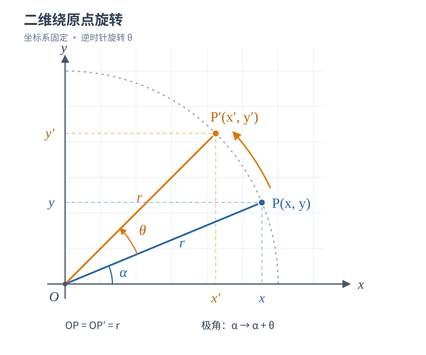
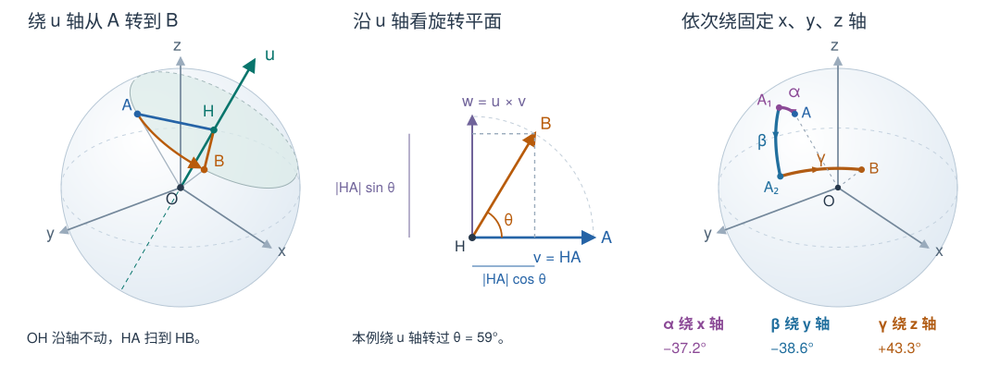
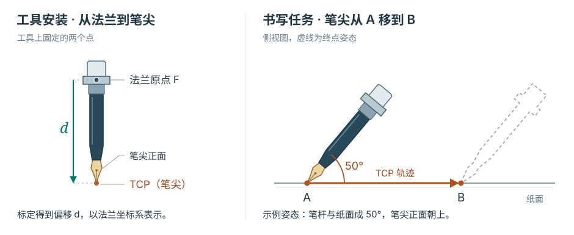

---

layout: post
title: 运动学
category: 技术
tags: MachineLearning
keywords: deepresearch deepsearch

---

* TOC
{:toc}

## 简介

1. 高中学习的运动学是质点运动学，即忽略一个物体自己本身的形状和姿态，只把它当成一个点，研究这个点的运动过程和轨迹。 描述一个物理的运功状态，需要两个量/位姿(Pose)：位置(xyz 空间坐标) + 姿态（旋转矩阵/欧拉角等）。以一架无人机为例：
  - 位置：无人机在房间的哪里。
  - 姿态：机头朝哪边、有没有抬头、机身有没有侧倾。
2. 机器人状态表示
  1. 关节空间，比如一个6自由度机械臂用 6个关节角来描述 这个机械臂当前的状态
  2. 笛卡尔空间（对应位姿），（比如机械臂末端的）xyx + 旋转角等
  对机械臂的控制也分为 关节空间控制(move j)，笛卡尔空间控制（move line），以6轴机械臂为例
3. 正运动学，关节空间 ==> 笛卡尔空间。目标位置 ==> 6个关节角目标值。
4. 逆运动学，笛卡尔空间 ==> 关节空间。当前6个关节角实际值 ==> 当前空间位置

## 理论基础

先想象物体身上也有一套坐标轴，除了固定在房间里的“世界坐标系”(world frame)，我们还可以把三根坐标轴固定在无人机上：
- x轴：指向机头。
- y轴：指向左侧。
- z轴：指向机顶。
这叫物体坐标系，也常叫局部坐标系（body frame）。无人机旋转时，这三根轴也一起转。描述姿态，就是描述：物体的这三根轴，相对于世界坐标轴，转到了什么方向。
1. 欧拉角：用三个转动角度描述姿态，直觉上，就像告诉你：先朝左转一点，再抬头一点，再侧倾一点。机器人里常见的三个名字是：
  1. Roll，横滚角，绕x轴机身左右侧倾。比如飞机机翼左右晃动。
  2. Pitch，俯仰角，绕y轴抬头或低头。比如飞机拉升、俯冲。
  3. Yaw，偏航角，绕z轴朝左或朝右转向。比如飞机左右拐弯。
  有一个关键点：三维旋转的顺序会影响结果。譬如手机，“先翻转，再转向”和“先转向，再翻转”，最后可能不同。因此，不同软件中的 roll, pitch, yaw 不能只看名字就直接互换。
2. 旋转矩阵：直接记录物体三根轴朝哪里。直觉上，“转完以后，物体的三根轴分别朝哪里”。
  1. 为什么要用矩阵？因为它方便计算坐标

### 三维空间的位置描述

我们要控制机械臂，最基础的问题，我们要告诉机器人/机械臂目标在哪里，描述一个点的位置最常用的是笛卡尔坐标系。三维空间中点的位置由三个独立坐标 (X, Y, Z) 唯一确定，但坐标值的物理意义完全依赖于**所选参考坐标系**。右手定则规定了坐标轴正方向的一致性约定，是后续所有向量运算与旋转变换的数学基础。
1. XYZ，笛卡尔坐标系用三个相互垂直的轴 (X, Y, Z) 描述空间位置，任意点 M 通过垂直于各轴的平面投影唯一对应有序数组 (X, Y, Z)，原点为 (0, 0, 0)。
2. 右手定则，规定坐标轴正方向：拇指 → X 轴正向、食指 → Y 轴正向、中指 → Z 轴正向，保证叉乘方向与旋转正方向在所有计算中保持一致。
3. 参考系，同一物理点在不同坐标系下坐标值不同，描述位置时须明确参考系，如 "相对于基坐标系的 (50, 20, 30)" 才是完整的工程表达。

### 为什么需要姿态

仅用 XYZ 只能描述点在**空间中的位置**，无法描述刚体的**朝向**。工业场景中同一目标点可对应无数种工具姿态，因此必须用 **6 个参数 (X, Y, Z, RX, RY, RZ)** 完整描述刚体的位姿，其中位置用 **3×1 平移向量**、姿态用 **3×3 旋转矩阵**表达。
1. 焊枪到达 A 点时可垂直、倾斜或水平，位置相同但工艺效果截然不同，**仅有位置信息不足以描述刚体状态**。
2. 完整描述刚体需要 6 个自由度：3 个位置分量 (X, Y, Z) 确定 "**在哪里**"，3 个姿态分量 (RX, RY, RZ) 确定"**朝哪个方向**"，合称 **6-DOF 位姿**。
3. 数学上，位置用 **3×1 平移向量 t** 描述，姿态用 **3×3 正交旋转矩阵 R** 描述，R 的每一列代表刚体坐标轴在参考系中的方向余弦。

### 旋转矩阵：计算旋转后的新坐标

在固定的直角坐标系中，规定 x 轴向右、y 轴向上，逆时针为旋转正方向。点 $P(x,y)$ 绕原点 $O$ 逆时针旋转 $\theta$ 后，得到点 $P'(x',y')$，如何计算它的新坐标？

设点 $P$ 到原点的距离为 $r$，向量 $\overrightarrow{OP}$ 与 x 轴正方向的夹角为 $\alpha$。用极坐标表示：

$$
x=r\cos\alpha,\qquad y=r\sin\alpha
$$

旋转 $\theta$ 后，极角变为 $\alpha+\theta$，到原点的距离 $r$ 保持不变。因此：

$$
\begin{aligned}
x'
&=r\cos(\alpha+\theta)\\
&=r\cos\alpha\cos\theta-r\sin\alpha\sin\theta\\
&=x\cos\theta-y\sin\theta
\end{aligned}
$$

同理：

$$
\begin{aligned}
y'
&=r\sin(\alpha+\theta)\\
&=r\sin\alpha\cos\theta+r\cos\alpha\sin\theta\\
&=x\sin\theta+y\cos\theta
\end{aligned}
$$

得到二维绕原点旋转公式：

$$
\begin{cases}
x'=x\cos\theta-y\sin\theta\\
y'=x\sin\theta+y\cos\theta
\end{cases}
$$

将坐标写成列向量，就可以用一次矩阵乘法表达这一变换：

$$
\begin{pmatrix}
x'\\
y'
\end{pmatrix}
=
\underbrace{
\begin{pmatrix}
\cos\theta & -\sin\theta\\
\sin\theta & \cos\theta
\end{pmatrix}
}_{R(\theta)}
\begin{pmatrix}
x\\
y
\end{pmatrix}
$$

其中，$R(\theta)$ 就是二维旋转矩阵。

在三维空间里，把球面上的 A 点转到 B 点，可以用两种方式描述这次旋转：

1. 依次绕固定的 x、y、z 轴，各转一个给定的角度。
2. 选一条经过球心 O 的轴，用单位向量 $\mathbf u$ 表示它的方向，让 A 绕这条轴转过 $\theta$。右手拇指指向 $\mathbf u$，四指弯曲的方向就是正向。

沿着第二种思路，已知 A 的坐标 $(x,y,z)$、旋转轴和角度，怎样算出 B 的坐标？从 A 向轴作垂线，垂足记为 H。转动时，H 固定在轴上，HA 像指针一样扫到 HB。**沿轴看过去，看到的正是前面推过的二维旋转，只是这次圆心在 H。**

记 $\mathbf a=\overrightarrow{OA}$。先沿轴走到 H，再从 H 走到 A，这两段分别为

$$
\mathbf h=\overrightarrow{OH}=(\mathbf u\cdot\mathbf a)\mathbf u,\qquad
\mathbf v=\overrightarrow{HA}=\mathbf a-\mathbf h.
$$

在这个圆内，取 HA 为水平方向，把它正向转 $90^\circ$ 得到等长的竖直向量 $\mathbf w=\mathbf u\times\mathbf v$。指针转过 $\theta$ 后，水平方向贡献 $\mathbf v\cos\theta$，竖直方向贡献 $\mathbf w\sin\theta$。再加上从 O 到圆心的那一段，就得到了 B 的位置：

$$
\overrightarrow{OB}=\mathbf h+\mathbf v\cos\theta+\mathbf w\sin\theta.
$$

和二维一样，剩下的工作就是收集 $x,y,z$ 的系数。设 $\mathbf u=(u_x,u_y,u_z)^\mathsf T$，简记 $c=\cos\theta$、$s=\sin\theta$、$k=1-c$。因为 $\mathbf h$ 平行于轴，$\mathbf w=\mathbf u\times\mathbf a$。以 B 的第一个坐标为例：

$$
\begin{aligned}
x_B &= cx+k\,u_x(u_x x+u_y y+u_z z)+s(u_y z-u_z y)\\
    &= (c+ku_x^2)x+(ku_xu_y-su_z)y+(ku_xu_z+su_y)z.
\end{aligned}
$$

这三个系数就是矩阵的第一行。对 $y_B,z_B$ 作同样的整理，三行排起来，左边的系数矩阵就是**绕轴 $\mathbf u$ 转过 $\theta$ 的三维旋转矩阵**：

$$
\begin{pmatrix}x_B\\y_B\\z_B\end{pmatrix}
=
\underbrace{\begin{pmatrix}
c+ku_x^2 & ku_xu_y-su_z & ku_xu_z+su_y\\
ku_xu_y+su_z & c+ku_y^2 & ku_yu_z-su_x\\
ku_xu_z-su_y & ku_yu_z+su_x & c+ku_z^2
\end{pmatrix}}_{R(\mathbf u,\theta)}
\begin{pmatrix}x\\y\\z\end{pmatrix}.
$$

取 $\mathbf u=(0,0,1)^\mathsf T$，就能认出熟悉的结果：$x_B=cx-sy$，$y_B=sx+cy$，$z_B=z$。前两式正是二维旋转公式，第三式说明绕 z 轴转动时高度不变。同理，取 x、y 轴可分别得到 $R_x,R_y$。回到第一种思路，依次绕固定的 x、y、z 轴转 $\alpha,\beta,\gamma$，前一步的终点就是下一步的起点。用列向量写，总矩阵为 $R_z(\gamma)R_y(\beta)R_x(\alpha)$，最先执行的旋转在最右边。

到这里，B 的三个坐标已经算出来了。把每个坐标式中 $(x,y,z)$ 的系数按行排起来，就得到矩阵 $R$，三个式子也就合成了一个式子 $\mathbf p_B=R\mathbf p_A$。这个 $R$ 就是该旋转在当前坐标系下的矩阵表示（线性映射的矩阵表示，矩阵连乘来表达计算/运动过程），称为**旋转矩阵**。多步计算遵循同一种规律时，矩阵可以保留这个规律，省去反复展开代数式，**这是使用矩阵代数的一个重要原因**。

旋转矩阵的乘法不满足交换律（$R_X R_Y \ne R_Y R_X$），这意味着同样的三个旋转角度，不同的旋转顺序会产生完全不同的最终姿态。因此定义姿态时必须同时指定角度值和旋转顺序，二者缺一不可。常见的顺序有3种
1. **固定轴**外旋XYZ，先绕固定X，再绕固定Y，最后绕固定Z，$R =R_z(\gamma)R_y(\beta)R_x(\alpha)$ 
2. 内旋（ZYX）**动轴**（坐标系跟着物体一起转）ZYX，先绕Z转，再绕新Y转，最后绕新X转
3. 经典ZYZ欧拉角，先绕Z转，再绕新Y转，最后让最新的Z转
采用3参数形态，当某一**中间旋转角达到 ±90°** 时，**首尾两次旋转退化为绕同一轴旋转**（比如绕x 转90度，y和z轴就重叠/共线了，cos90=0），**丢失一个自由度**—— 这就是万向锁。它是欧拉角参数化方法的数学固有缺陷，工程上通过限制角度范围或改用四元数来规避。

## 机械臂

通常被称为多关节机械手，它模仿了人类手臂的部分功能，能够进行抓取、搬运、装配、喷涂等各种精密作业。所有的转动、移动都是通过发动机、马达去做对应的驱动。link 与link 之间的运动都是通过joint/电机去做的，实现空间中到达某个位置。

1. 示教器，机械手的 "交互窗口" 与 "遥控器"。
  1. 手动点动：操作机械臂移动
  2. 程序编写：编写与调试运动逻辑
  3. 状态监控：实时查看运行状态与急停
2. 控制器，机械手的 "大脑"。
  1. 算法核心：运行正 / 逆运动学计算，将空间坐标转换为电机角度
  2. 轨迹规划：计算从 A 点到 B 点的最优路径，防碰撞
  3. 伺服驱动：向电机下达精确的转速和扭矩指令
  4. 安全监控：实时监测碰撞、过载、超限等异常

### TCP(Tool Center Point)：从 A 到 B，移动的是哪个点？

纸上有两个点 A、B，希望机械臂在两点之间画一条直线。机械臂最后一节有个安装工具的接口，叫工具法兰（tool flange）；笔装在法兰上，离纸最近的是笔尖。画线任务关心的是笔尖走过的轨迹，所以把笔尖选作 TCP（Tool Center Point，工具中心点），**用来解耦“工具要完成什么动作”和“这把工具怎样装在机械臂上”**。控制器能根据关节角算出工具法兰的位置和朝向，但装在法兰上的笔伸出了多长、笔尖偏向哪一侧，单靠关节角算不出来。这些量取决于工具本身和实际安装方式。

这就需要标定，就是确定实际工作点相对于法兰的位置。比如一支笔实际伸出 150 mm，控制器里却配置成 140 mm。你让笔尖对准纸上的 A 点，控制器认为已经到位，实际笔尖却会沿笔杆方向多伸出 10 mm。标定步骤
1. 以4种不同的姿态触碰同一个固定尖点，每次触碰时记录关节角。通常是人工换姿态、人工对点，支持拖动示教的机器人也可以用手引导机械臂完成对点。
2. tcp 始终指向同一个固定点，每次法兰中心到该固定点的距离R
3. 解方程：X、Y、R

如果把笔换成钢笔，一般钢笔书写时，笔尖正面/刻字面朝上，笔与纸面的夹角45°～60°。则除了笔尖落在哪里，还要考虑笔尖以什么姿态接触纸面。试着让笔尖停在 A 点，保持笔杆的倾斜方向不变，只绕笔杆转半圈：笔尖还在 A，笔尖的正面却翻到了另一侧。前面的四点法确定了工具坐标系的原点；要描述钢笔的完整姿态，还要定义坐标轴。比如让工具的 $+z$ 轴沿笔杆指向笔尖，再用笔尖的正面确定绕 $z$ 轴的朝向。

$$
\mathbf p_{\mathrm{TCP}}=\mathbf p_F+R_F\,\mathbf d.
$$

这里 $\mathbf d$ 是笔尖在法兰坐标系中的固定偏移。$R_F$ 把这段偏移转到基座坐标系，再加上法兰原点的位置 $\mathbf p_F$，就得到笔尖的位置。

把工具坐标系的原点放在 TCP，三根轴固定在钢笔上。示教时，让原点沿 A 到 B 的直线走，就指定了笔尖的轨迹；指定这些轴相对纸面的方向，就指定了书写姿态。

### 坐标系

1. 关节坐标系，比如六轴机械臂 J1到J6
2. 基坐标系，绝对笛卡尔空间/世界坐标系
3. 工具坐标系，末端笛卡尔空间

